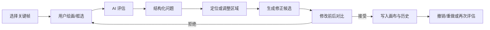

# FrameFlow

FrameFlow 是一个面向动画分镜创作的 AI 协作编辑器 MVP。它用可操作的“评估 → 定位 → 候选修正 → 人类确认”闭环展示 human-in-the-loop 工作方式；当前只使用确定性的 Mock AI，不调用真实模型。

> 项目重点是人机协作逻辑和绘画工作流，而不是复杂画板功能或真实模型基础设施。

## 核心功能

- 16:9 React Konva 画布：画笔、颜色/粗细、仅擦除用户笔画的橡皮擦、矩形选区。
- 三个独立动画关键帧，分别保存场景、用户笔画、revision 与撤销/重做历史。
- Mock AI 结构化评估、问题卡片、画布区域定位、忽略问题与空状态。
- Mock AI 局部修正：修改 Prompt、修改前/后对比、接受、拒绝、重新生成。
- Frame 02 右臂姿态和 Frame 03 斗篷颜色的真实可见修正；接受后可撤销/重做。
- 异步结果通过 `frameId + revision` 防过期，旧结果不会覆盖新画布。
- localStorage 自动恢复、演示项目重置、无辅助标记的当前帧 PNG 导出。

## 技术架构

- React + TypeScript + Vite：应用与构建。
- Tailwind CSS 基础管线 + 定制工作台样式。
- React Konva：基础场景、用户笔画、AI 修正状态和交互覆盖层分层渲染。
- Zustand：可序列化编辑器状态、分帧历史与 AI 工作流状态。
- Vitest：状态机与 Mock AI 服务自动化测试。

AI 服务由接口隔离：`src/services/ai/types.ts` 定义 `Evaluator` 与 `ImageCorrector`，当前实现分别位于 `mockEvaluator.ts`、`mockCorrector.ts`。UI 只依赖接口导出的服务实例。

## 工作流程



## 快速启动

运行环境：Node.js 18 或更高版本，推荐使用当前 LTS 版本。

```bash
npm install
npm run dev
```

启动后访问终端输出的本地地址，默认通常为 `http://localhost:5173`。

生产检查：

```bash
npm run typecheck
npm test
npm run build
```

## 核心目录

```text
src/
├── components/
│   ├── ai/          # AI 评估、问题卡片与修正预览
│   ├── editor/      # Canvas、工具栏和关键帧时间轴
│   └── layout/      # 编辑器工作台布局
├── scenes/          # 森林演示场景与默认关键帧
├── services/ai/     # AI 接口、Mock 评估与 Mock 修正
├── stores/          # Zustand 编辑器状态与历史管理
├── types/           # 画布和关键帧类型
└── utils/           # PNG 导出与本地持久化
```

## 演示指南

1. Frame 02：点击“AI 评估当前画面”，定位右臂问题，点击“AI 修正”，在对比弹窗确认右臂方向变化后接受；再次评估将显示无待修正问题。
2. Frame 03：评估会识别蓝色斗篷不一致。生成候选后可拒绝（画布不变），也可接受红色斗篷；随后用左侧撤销/重做验证变化可逆。
3. 可随时用画笔绘制、切换帧后返回验证独立保存，再导出当前帧 PNG。刷新页面后主要项目数据会恢复。

## 技术取舍

MVP 是完全可本地运行的前端，状态规模适合 localStorage，因此没有引入后端、数据库、认证、WebSocket 或任务队列。工作流目前是明确的有限状态机，也不需要 LangGraph；这些组件只有在真实模型带来长任务、重试、多人协作或云端项目管理时才有价值。

## 接入真实 AI

1. 在 `src/services/ai/` 新增实现 `Evaluator` 的 `RealLLMEvaluator`，上传当前帧与相邻帧快照、目标和约束，并校验模型返回的结构化 JSON。
2. 新增实现 `ImageCorrector` 的 `RealImageCorrector`，提交图片、mask/归一化区域、Prompt 与保留约束，返回可预览图片或可应用的场景数据。
3. 在服务组合层替换实例即可；保留现有 frame/revision 校验、候选预览和人工接受流程，无需重写 UI。
4. 生产环境应由服务端代理密钥，并加入超时、取消、重试、内容安全和对象存储。

## AI Coding 开发记录

- 工具：OpenAI Codex。
- 模型：GPT-5 系列 Codex；当前运行环境未暴露更细的可验证模型版本号。
- Token 消耗与统计方法：当前运行环境未提供可验证的逐项目 Token 计数，因此不编造数值；应以平台会话用量或组织账单导出为准。
- Token 消耗较多的工作：长规格解析、跨阶段状态一致性设计与完整 UI 实现。
- 开发者投入时间最多的部分：未由开发者提供，无法如实统计。
- 主要技术问题：用可序列化快照实现分帧撤销/重做；以 frameId/revision 双重校验隔离过期异步结果；导出时临时隐藏交互覆盖层。

## 当前限制

Mock AI 只支持规格规定的两个预置问题，不具备通用图像理解或修复能力；场景为内置矢量素材；项目只保存在当前浏览器；桌面端优先，最小宽度为 1120px。
